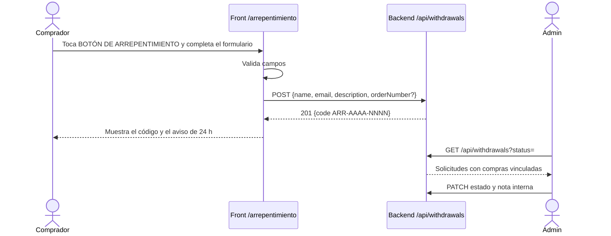

# Flujo: Botón de arrepentimiento (lado usuario y admin)

## Objetivo
Que cualquier comprador pueda pedir la revocación de una compra a distancia sin registrarse (Disposición 954/2025) y que el admin la gestione.

## Actores
- Comprador, con o sin cuenta.
- Admin.
- Backend `/api/withdrawals` (ver el flujo del lado servidor en el repo del backend).

## Pre-condiciones
- Backend con la tabla de solicitudes y la numeración de pedidos aplicadas (script SQL).
- Alguien del negocio revisa el panel dentro de las 24 h.

## Pasos principales (happy path)
1. El comprador toca "BOTÓN DE ARREPENTIMIENTO" en el Footer (visible también mientras carga).
2. En /arrepentimiento completa nombre, email, qué compró y, si quiere, el N° de pedido (lo ve en "Mis compras"). Con sesión, nombre y email vienen precargados.
3. Al enviar recibe el código ARR-… en pantalla. No se envía mail: puede copiarlo.
4. El admin ve la solicitud en Admin > Arrepentimientos, con las compras vinculadas por email, la pasa a "En gestión" y luego a "Resuelta" o "Rechazada" con una nota interna.

## Caminos alternativos
- Sin N° de pedido: se vincula por email; si no hay coincidencia queda marcada "Requiere revisión manual".
- Admin con sesión abierta: la ruta no lo redirige a /admin.

## Errores esperados
- Campos inválidos -> error por campo, no se envía.
- 429 -> "Hiciste varios intentos seguidos. Esperá unos minutos".
- 500 o red caída -> mensaje humano; lo escrito se conserva para reintentar.
- Columna `order_number` ausente en la base -> Ventas y Despachos siguen funcionando sin mostrar el número.

## Diagrama

## Datos involucrados
- Entrada: nombre, email, descripción, N° de pedido opcional.
- Salida: código de seguimiento.
- Persistencia: tabla de solicitudes en el backend; el front no guarda nada.
