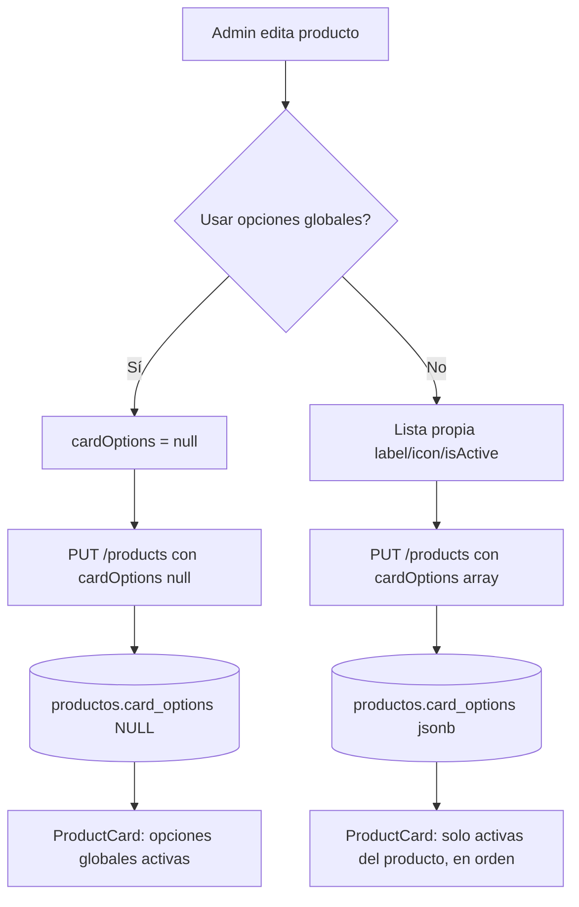

# Flujo: Opciones de card de producto

## Objetivo
Definir qué sellos (Mercado Pago, cuotas, envío gratis, etc.) muestra cada card del listado, globalmente o por producto.

## Actores
- Admin (configura).
- Visitante / usuario (ve las cards).
- Backend `/products` y Supabase (`productos.card_options`, `product_card_options`).

## Pre-condiciones
- Columna `productos.card_options` (jsonb) creada en la base.
- Opciones globales en `product_card_options` (se gestionan en Admin > Productos > "Opciones de la card de producto").

## Pasos principales (happy path)
1. El admin abre un producto > pestaña Promociones > "Opciones de la card".
2. Desactiva "Usar opciones globales" y arma la lista (texto, ícono, activa, orden; máx 10).
3. "Ver vista previa" muestra la card con esos sellos; "Confirmar" envía `cardOptions` en POST/PUT `/products`.
4. La tienda lee `card_options` junto al producto; `ProductCard` muestra solo las opciones activas del producto, en su orden.

## Caminos alternativos
- `cardOptions = null` (toggle activado): la card usa las opciones globales activas.
- `cardOptions = []` o todas inactivas: la card no muestra sellos.
- Al reactivar "Usar opciones globales" con opciones propias cargadas se pide confirmación; al confirmar se descartan y se envía `null` explícito en el PUT.
- `card_options` con forma inválida en la base: se trata como `null`.

## Errores esperados
- Texto vacío o duplicado (sin distinguir mayúsculas) -> error inline, no se agrega.
- Más de 10 opciones -> el alta queda deshabilitada con mensaje.
- Falla del guardado -> mensaje del flujo existente de vista previa; nada cambia en la tienda.

## Diagrama

## Datos involucrados
- Entrada: `cardOptions: null | { label (1..40), icon, isActive }[]` (máx 10).
- Persistencia: `productos.card_options` (jsonb); globales en `product_card_options`.
- Salida: sellos en `ProductCard` (listados Home y catálogo; el detalle no cambia).
