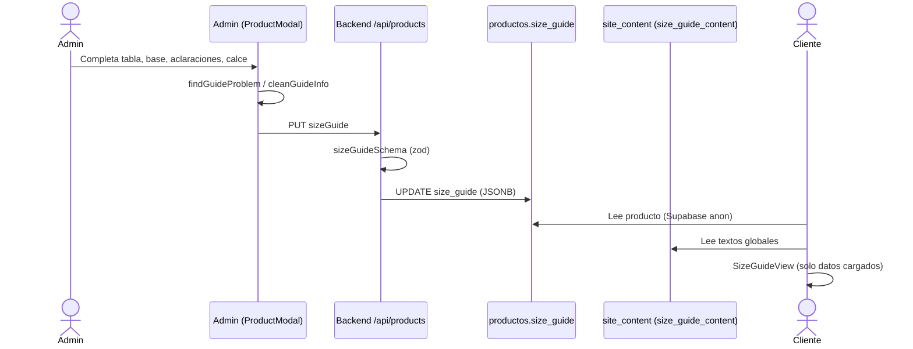

# Flujo: Guía de talles de un producto

## Objetivo
Publicar en cada producto una guía de talles clara y verificable, sin mostrar datos que el admin no confirmó.

## Actores
- Admin (carga talles globales, textos globales y la guía de cada producto)
- Cliente (consulta "Ver guía de talles" en el detalle)
- Backend `/api/products` (valida y guarda `productos.size_guide`)
- Supabase `site_content` (textos globales, clave `size_guide_content`)

## Pre-condiciones
- Producto con al menos una variante (si no, no hay botón de guía).
- Para los textos globales: sesión admin (RLS de `site_content`).

## Pasos principales (happy path)
1. El admin abre un producto > Variantes > Guía de talles.
2. Una guía nueva de indumentaria arranca con filas Busto/Cintura/Cadera/Entrepierna vacías.
3. Elige talles (globales o propios) y carga valores reales (fabricante o prenda medida).
4. Indica unidad y si las medidas son corporales o de la prenda.
5. Opcional: aclaraciones propias y referencia de calce con datos reales de la modelo.
6. Vista previa → se valida la guía → Guardar: `PUT /api/products` con `sizeGuide`.
7. El cliente abre la guía: tabla, cómo medirse, aclaraciones y calce.

## Caminos alternativos
- Si no toca la estructura precargada → no se guarda guía; la tienda dice "pendientes de completar".
- Si la tabla está incompleta → celdas "Pendiente" y aviso.
- Si la guía no indica la base o no tiene valores → no se muestra la aclaración "corresponden a …".
- Si no hay aclaraciones propias → se usan las globales (cambiar las globales impacta en todos esos productos).
- Si la guía es de calzado o el producto no tiene guía → no se muestra "¿Cómo tomar tus medidas?".
- Si la referencia de calce no tiene datos de texto o la foto ya no es del producto → se oculta el bloque o la foto.
- Si se elige un talle global → sus medidas se copian a la guía (snapshot); editar el talle global después no cambia guías ya guardadas.

## Errores esperados
- Valor sin número, fila sin nombre, medida repetida, altura fuera de 100–230, foto ajena, aclaración vacía → mensaje en Variantes, no deja continuar.
- Payload inválido directo a la API → 400 de validación.
- Falla al cargar textos globales → admin: "Reintentar" sin formulario; tienda: textos por defecto (genéricos).

## Diagrama

## Datos involucrados
- `productos.size_guide`: `type`, `columns`, `rows`, `columnSources` (existentes) + `unit`, `measurementBasis`, `notes`, `fitReference` (opcionales, nuevos).
- `site_content['size_guide_content']`: `howToMeasure` (busto, cintura, cadera, entrepierna) y `notes` (con token `{medidas}`).
- `talles.measurements`: un talle global nuevo precarga los nombres de las medidas estándar.
